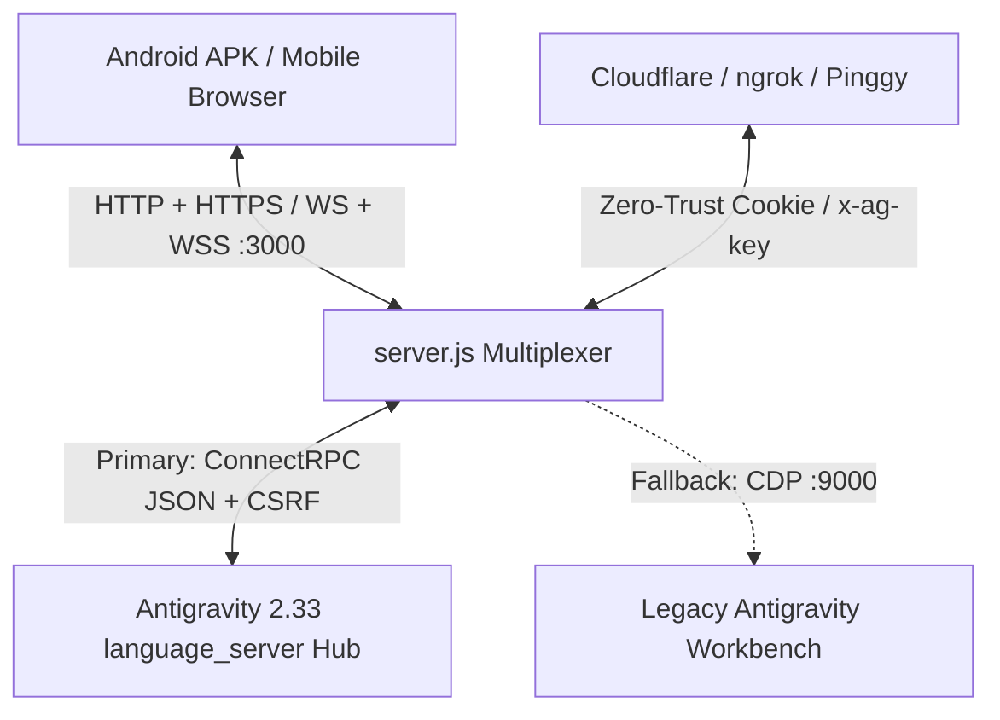

# CODE DOCUMENTATION — Antigravity Remote Control v6.0

## Project Structure
```text
Remote-Control/
├── hub_bridge.js                   # Antigravity 2.33+ Hub / LanguageServer ConnectRPC bridge
├── server.js                       # Express + WebSocket + Dual HTTP/HTTPS multiplexer + CDP fallback
├── generate_ssl.js                 # Self-signed SSL certificate generator (OpenSSL / Node crypto)
├── ui_inspector.js                 # Diagnostic inspector for legacy CDP DOM trees
├── launcher.py                     # Unified Python supervisor (Node server, tunnels, Magic QR codes)
├── public/                         # Antigravity 2.33 Mobile Web Frontend (mirrored to Android assets)
│   ├── index.html                  # Obsidian & Light UI shell, Surface Composer, Hub Drawer
│   ├── login.html                  # Tunnel passcode login screen
│   ├── manifest.json               # Web App Manifest
│   ├── css/style.css               # Antigravity 2.33 design tokens, diff hunks, responsive layout
│   └── js/app.js                   # Live WebSocket stream, model/mode sheets, /slash menu, approvals
├── android/                        # Native Android Application (Kotlin + Jetpack Compose + WebView)
│   └── app/src/
│       ├── main/java/com/antigravity/remotecontrol/
│       │   ├── MainActivity.kt     # Compose Connection Hub, RemoteSessionScreen, AndroidBridge
│       │   └── ServerDiscovery.kt  # Parallel LAN scanner, URL parser, WebView URL classifier
│       ├── main/assets/www/        # Bundled offline preview frontend synchronized with public/
│       └── test/java/.../          # JUnit 4 unit tests (ServerDiscoveryTest.kt)
├── tests/
│   └── verify_remote_control.mjs   # End-to-end Hub RPC, Express/WS, binary upload & Headless Chrome tests
├── shortcuts/
│   ├── Phone Connect (Home).bat    # One-click Windows LAN launcher
│   └── Phone Connect (Outside).bat # One-click Windows Global Tunnel launcher
├── start_ag_phone_connect.bat/.sh  # Cross-platform LAN launchers
├── start_ag_phone_connect_web.*    # Cross-platform Global Web Tunnel launchers
└── Antigravity-Remote-Control-v6.0.apk # v2-signed Android release APK
```

---

## High-Level Architecture (Hybrid Hub ConnectRPC + CDP Fallback)

In **v6.0**, Antigravity Remote Control communicates directly with the local **Antigravity 2.33+ `language_server` daemon** over **ConnectRPC** (`exa.language_server_pb.LanguageServerService/*`), discovered automatically from `~/.gemini/antigravity/daemon/hub_*.json`. Launching Antigravity with `--remote-debugging-port=9000` is **no longer required**, though legacy Chrome DevTools Protocol (CDP) DOM mirroring remains built in as an automatic fallback.



---

## Core Modules

### 1. `hub_bridge.js` (`AntigravityHubBridge`)
- **Zero-Flag Daemon Discovery (`discoverHub`)**: Scans `~/.gemini/antigravity/daemon/hub_*.json`, validates liveness via `GetUserStatus`, and caches CSRF credentials, HTTP/HTTPS ports, user plan info, and live model quotas.
- **Model & Execution Mode Management (`refreshModels`, `setModelByLabel`, `setMode`, `buildCascadeConfig`)**:
  - Supports all 24 Antigravity 2.33 model entries (23 active + 1 Ultra-gated) across **Gemini 4 Neon** (default `High`; `Low`/`Medium`/`High`/`XHigh`), **Orchestrator** (`Neon`, `Argon`), **Gemini 4 Argon**, **Gemini 4 Hydrogen**, **Gemini 3.8 Flash**, **Claude Opus 5.5**, **Claude Sonnet 5.5**, **GPT-OSS 120B**, and disabled **Gemini 4 Carbon** (`Unavailable`), plus legacy `Claude 4.6` fallback.
  - Maps `Agent` (`AUTO`), `Autonomous` (`EAGER`), `Planning` (`OFF` + auto `/plan`), and `Fast` (`Gemini 3.8 Flash (High)` override with automatic restoration of the prior model when switching back).
  - Preserves exact Antigravity 2.33 `userConfig` structure (`plannerConfig`, `executorConfig: { useCoreDirect: true }`, `conversationHistoryConfig: {}`).
- **Trajectory & Swarm Rendering (`listConversations`, `buildSnapshotFromHub`)**:
  - Builds recursive L1/L2+ subagent hierarchies from `GetAllCascadeTrajectories`.
  - Renders `GetCascadeTrajectory` steps into mobile cards: user prompts with `/slash` and file badges, thinking token accordions, structured Markdown responses (`renderMarkdownLite`), `📝 Wrote` / `✏️ Edited` / `🗑️ Deleted` file pills with `+additions`/`-deletions` and unified diff hunks (`CORTEX_STEP_TYPE_CODE_ACTION`), active and completed `CORTEX_STEP_TYPE_GENERIC` tools (`run_command`, `send_message`, `swarm_*`, `run_workflow`, `manage_task`, `schedule`), `invoke_subagent` drill-down cards, search/MCP/browser/error steps, and interactive `WAITING` approvals/questions.
  - Strictly excludes `CORTEX_STEP_SOURCE_SYSTEM_SDK` steps so internal SDK prompt reminders never leak into snapshots.
- **Interactive Decisions (`handleInteraction`)**: Submits `Approve`/`Deny` (`permission`, `filePermission`, `runCommand`, `browserAction`) and single/multi-select + write-in `ask_question` answers via `HandleCascadeUserInteraction`.

### 2. `server.js`
- **Single-Port HTTP + HTTPS Multiplexer**: Inspects the first TCP byte (`0x16` TLS `ClientHello`) on `PORT` (default `3000`) so `http://`/`ws://` and `https://`/`wss://` work simultaneously on the same port.
- **Zero-Trust Tunnel Auth**: Exempts RFC-1918 local Wi-Fi clients while enforcing signed `httpOnly` (`SameSite=Lax`) cookies, `?key=` Magic Links, or `x-ag-key` headers across all HTTP and WebSocket connections arriving through external tunnels.
- **Race-Safe Polling & Immediate Broadcast**: Polls Hub trajectories (falling back to CDP) and discards stale in-flight polls if `activeCascadeId` changes mid-RPC.

### 3. `android/` (`MainActivity.kt` & `ServerDiscovery.kt`)
- **Connection Hub**: Scans local `/24` subnets concurrently (`ServerDiscovery.scanSubnetForServers`), validating `/health` (`service == "antigravity-remote-control"`) to list live PCs alongside manual IP/tunnel entry and offline UI preview (`file:///android_asset/www/index.html`).
- **Hardened Session WebView (`QuotableWebView`)**: Wires `AndroidBridge` (haptics, clipboard, status-bar theme sync, session key persistence, document picker uploads, microphone permissions), injects native `"❝ Quote"` and `"💬 /btw"` actions directly into Android's OS floating text-selection `ActionMode` toolbar (`window.__quoteNativeSelection`), and enforces `shouldOverrideUrlLoading` (`ServerDiscovery.classifyWebViewNavigation`) so same-server routes stay in-app, external links open in Android's browser, workspace `file:///` paths copy cleanly to clipboard, and unsafe schemes (`javascript:`, `intent:`) are blocked.

---

## HTTP & WebSocket API Reference

| Endpoint | Method | Description |
| :--- | :--- | :--- |
| `/health` | `GET` | Server health, version (`6.0.0`), `hubConnected`, `lsVersion`, `apkAvailable`, `https`. |
| `/snapshot` | `GET` | Current conversation snapshot (`html`, `hash`, `cascadeId`, `parentCascadeId`, `isGenerating`). |
| `/app-state` | `GET` | Active `mode`, `model`, `activeCascadeId`, `lsVersion`, `isGenerating`, and user plan metadata. |
| `/get-models` | `GET` | Live 24-entry model catalog with `family`, `effort`, `tagTitle`, `tagDescription`, `disabled`, `supportsImages`, and `remainingFraction` / `weeklyRemainingFraction` quota info. |
| `/set-model` | `POST` | Selects active model by label, ID, or enum (`{ model }`); rejects disabled/unavailable models with HTTP `400`. |
| `/set-mode` | `POST` | Sets execution mode (`Agent`, `Autonomous`, `Planning`, or `Fast`). |
| `/slash-commands` | `GET` | Complete `/` catalog: System actions (`/btw`, `/boost`, `/swarm`, `/plan`, `/goal`, `/compact`, `/teamwork`, `/grill-me`, `/browser`, `/learn`, `/schedule`, `/help`), Skills, Plugins, Workspace Workflows (`ListProjects`/`ReadProjects` + `GetAllWorkflows` + `.agent/workflows/*.md` with normalized `file:///` URIs), MCP Prompts (`ListMcpPrompts`), and Client Controls (`/new`, `/stop`, `/model`, `/mode`, `/fast`, `/theme`, `/clear`, `/history`). |
| `/send` | `POST` | Sends clean prompt text, leading system `/` scope items, native `textBlock` response/code/file-range/side-question quotes (`Quote` / `code_block`) with paired per-quote specific answers, `/btw` non-interrupting `CORTEX_TRAJECTORY_TYPE_SIDE_QUESTION` forks (`UpdateConversationAnnotations`), `recipe` + `mcpPrompt` scope items, and direct clean-prompt multimodal/file `media` attachments (`SendUserCascadeMessage`). |
| `/stop` | `POST` | Cancels active cascade tree (`ForceStopCascadeTree` + `CancelCascadeInvocation`). |
| `/new-chat` | `POST` | Starts and selects a new conversation (`StartCascade`). |
| `/chat-history` | `GET` | Lists root conversations with nested recursive L1/L2+ subagent worker trees. |
| `/select-chat` | `POST` | Switches active conversation or drills into a subagent (`{ cascadeId, title, index }`). |
| `/delete-chat` | `POST` | Deletes a conversation trajectory (`DeleteCascadeTrajectory`). |
| `/hub-interact` | `POST` | Submits `Approve`/`Deny` or `ask_question` responses (`HandleCascadeUserInteraction`). |
| `/quota` | `GET` | Live 3-group Weekly & 5-hour model quota (`Gemini Models`, `Gemini 4 Argon`, `Claude and GPT models`), reset countdowns, user tier, and active context window usage. |
| `/export-chat` | `GET` | Exports the active (or `?cascadeId=`) conversation trajectory as clean Markdown. |
| `/swarm` | `GET` | Full Antigravity 2.33 Swarm UI snapshot (`members`, `messages`, `channels`, `edges`, `overview`, `systemAttention`, `raw`, `etag` fast-path). |
| `/swarm/list` | `GET` | Lists recent native swarms discovered under `~/.gemini/antigravity/brain/*/.system_generated/swarm/`. |
| `/ide/status` | `GET` | Active workspace, discovered desktop binaries (`Antigravity` vs `Antigravity IDE`), and target mode. |
| `/ide/switch-target` | `POST` | Switches active desktop target (`antigravity` vs `ide`) and workspace root. |
| `/ide/open-desktop` | `POST` | Launches or focuses the workspace or `file:line` (`--goto`) in desktop Antigravity IDE. |
| `/ide/files` | `GET` | Lists or searches files inside the active workspace (`resolveSafeWorkspacePath` canonical guard). |
| `/ide/file` | `GET`/`POST` | Reads or saves a text file inside the active workspace (`403` on any path outside workspace). |
| `/ide/git` | `GET` | Returns `git status` branch/ahead/behind/changed files and unified file diffs (`?diffFile=`). |
| `/upload-attachment` | `POST` | Saves binary (`dataUrl` base64) or plain-text attachments byte-for-byte to `uploads/`. |
| `/upload-media` | `POST` | Direct clean-prompt media upload + send (native `media` attachment without prompt path clutter). |
| `/hub/media` | `GET` | Streams trajectory & `uploads/` media files safely with HTTP `Range` support for lightbox/preview. |
| `/apk-status` | `GET` | Metadata (`available`, `sizeMb`, `downloadUrl`) for `Antigravity-Remote-Control-v6.0.apk`. |
| `/download/apk` | `GET` | Streams `Antigravity-Remote-Control-v6.0.apk` (`application/vnd.android.package-archive`). |
| `/login` / `/logout` | `POST` | Tunnel passcode authentication (`ag_auth_token` signed cookie). |
| `/ssl-status` / `/generate-ssl` | `GET`/`POST` | Checks or generates self-signed TLS certificates in `certs/`. |
