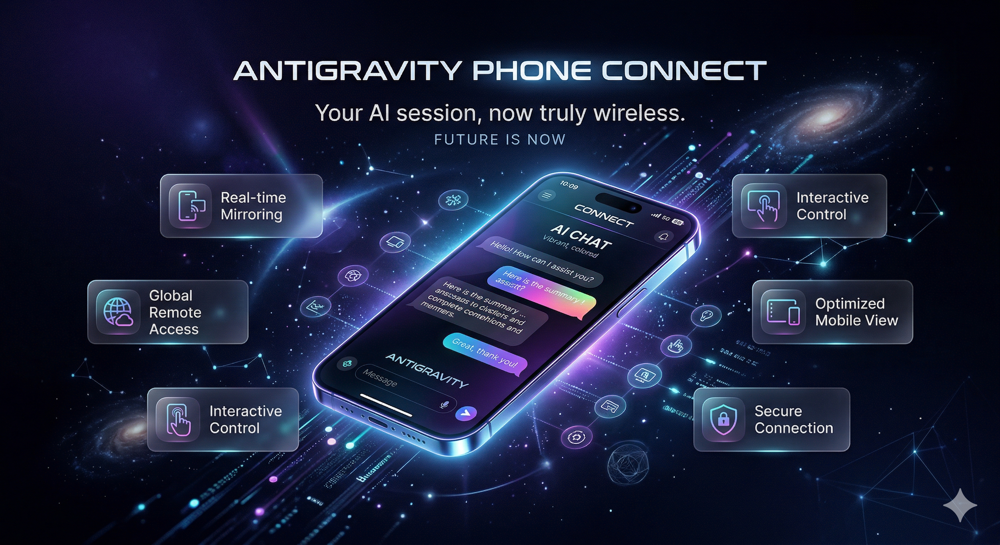
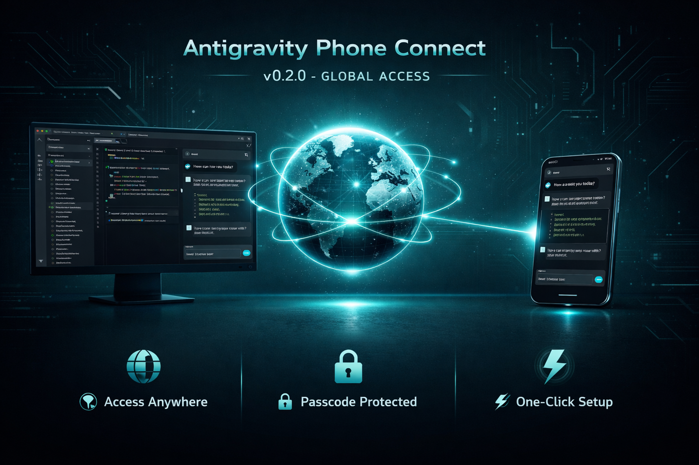

<div align="center">
  
  <h1>Antigravity Remote Control v6.0 📱</h1>
  <p><b>Agentic Hub 2.33 · Gemini 4 &amp; Swarm Mobile Web + Native Android APK</b></p>
  <p>
    📖 <a href="./docs/SETUP_GUIDE_EN.md"><b>English A-to-Z Setup &amp; GitHub Guide</b></a>
    &nbsp;·&nbsp;
    🇮🇷 <a href="./docs/SETUP_GUIDE_FA.md"><b>راهنمای کامل نصب و راه‌اندازی از صفر تا صد (فارسی)</b></a>
  </p>
</div>

[](https://www.gnu.org/licenses/gpl-3.0)
[](./RELEASE_NOTES.md)
[](./hub_bridge.js)
[](#platform-support)
[](https://github.com/Edge-Of-Future-TG/Antigravity-Remote-Control/actions/workflows/linux-ci.yml)

**Antigravity Remote Control (Phone Connect v6.0)** is a real-time mobile command center and native Android client for **Antigravity 2.33 Agentic Hub**. Step away from your desk while retaining full control over multi-agent `/swarm` and `/boost` pipelines, live code diffs, terminal approvals, interactive agent questions, and the full Antigravity 2.33 AI model catalog.

- **⚡ Zero-Flag Hub ConnectRPC**: Auto-discovers Antigravity 2.33 via `~/.gemini/antigravity/daemon/hub_*.json` with automatic CDP fallback — **no `--remote-debugging-port=9000` needed**.
- **🤖 Native Android APK (`Antigravity-Remote-Control-v6.0.apk`)**: Wi-Fi auto-discovery, tunnel login (`?key=` QR), native file/voice/haptics bridge, and offline UI demo.
- **🧠 24 Model Variants + Live Quota (`/quota`)**: Grouped selector for **Gemini 4** (`Neon`, `Argon`, `Hydrogen`, gated `Carbon`), **Orchestrator**, **Gemini 3.8 Flash**, **Claude 5.5**, and **GPT-OSS 120B**, with 3-bucket weekly/5h limits and context window tracking.
- **🐝 Hive Swarm Board (`/swarm-ui`)**: 5-tab mobile monitor (`Overview`, `Board`, `Members`, `@Mention Graph + Replay`, `Raw`) with live Pixel-Bee sprites and coordinator quick dock.
- **💻 Antigravity IDE Workspace (`/ide`)**: Browse workspace files, view/edit code, quote line ranges, inspect `git status` diffs, switch desktop Hub/IDE targets, or `↗ Open on PC`.
- **⚡ Full `/` Actions & QoL Tools**: Inline `/` autocomplete (workflows, skills, MCP prompts, `/boost`, `/swarm`, `/btw`), plus in-chat `/find`, `.md` `/export`, and `/prompts` history.
- **❝ Smart Response Quoting**: Quote full turns (`❝ Quote & Reply`), individual blocks (`☷ Quote Parts`) with per-quote answers, code blocks, or Android OS text selections.
- **🔒 Dual HTTP + HTTPS on Port 3000**: Frictionless local Wi-Fi access and Zero-Trust (`cookie` / `x-ag-key` / `?key=`) authentication over public Cloudflare, Pinggy, Serveo, and ngrok tunnels.





**Note:** Originally evolved from [Antigravity Shit-Chat](https://github.com/gherghett/Antigravity-Shit-Chat) by gherghett and upgraded to the v6.0 Antigravity 2.33 Agentic Hub & Android architecture.

---

## 🖥️ Platform Support

| Component | Status | Notes |
| :--- | :--- | :--- |
| **Host PC — Windows 10 / 11** | ✅ **Verified & Supported** | Tested end-to-end with live Antigravity 2.33+ Hub ConnectRPC, Local Wi-Fi QR, Web Tunnels (`cloudflare` / `pinggy`), and `npm test`. |
| **Host PC — Linux (Ubuntu / Debian)** | 🧪 **Experimental / Untested** | Not tested on a real Linux desktop/environment yet. Linux fixes, `.sh` launchers, [GitHub Actions Linux CI](./.github/workflows/linux-ci.yml), and mock-Hub checks ([`npm run test:linux`](./tests/verify_linux.mjs)) are included; contributions/feedback welcome. |
| **Mobile Client — Android** | ✅ **Verified & Supported** | Tested on physical Android hardware (`Antigravity-Remote-Control-v6.0.apk` + mobile Chrome). |
| **Host PC — macOS & Mobile iOS** | 🧪 **Experimental / Untested** | Standard web UI & macOS code paths exist for contributors, but have not been tested on physical Apple hardware. |

---

## 🚀 Quick Start (Zero-Flag Hub Mode — Windows & Linux)

In **v6.0**, you no longer need to launch Antigravity with `--remote-debugging-port=9000`. As long as Antigravity 2.33+ is open on your PC, `hub_bridge.js` discovers the live Hub daemon automatically.

### Step 1: Open Antigravity 2.33+ on Your PC
Simply launch **Antigravity** normally. *(Optional: Legacy CDP mode via `antigravity . --remote-debugging-port=9000` is still supported as an automatic fallback if the Hub daemon is unavailable.)*

### Step 2: Start the Remote Control Server

**Windows (Local Wi-Fi):**
```bat
start_ag_phone_connect.bat
```
*(Or use `shortcuts\Phone Connect (Home).bat` for LAN mode, or `shortcuts\Phone Connect (Outside).bat` for Web Tunnel mode.)*

**Linux (Ubuntu / Debian — Local Wi-Fi):**
```bash
chmod +x start_ag_phone_connect.sh   # First time only
./start_ag_phone_connect.sh
```

**Direct Node.js Start (Windows / Linux):**
```bash
npm start
```

The launcher automatically:
- Verifies Node.js & Python virtual environment (`venv`) dependencies
- Frees any stale process occupying port `3000`
- Connects directly to the live Antigravity 2.33 Hub ConnectRPC daemon
- Displays a **QR Code** and local endpoint (e.g., `http://192.168.1.20:3000` / `https://192.168.1.20:3000`)

### Step 3: Connect from Android APK or Mobile Browser

#### Option A: Native Android App (`Antigravity-Remote-Control-v6.0.apk`) — Recommended
1. Download `Antigravity-Remote-Control-v6.0.apk` from **GitHub Releases** (or build from source on Windows `.\gradlew.bat` or Linux `./gradlew` via `cd android && ./gradlew testDebugUnitTest assembleRelease`) and install it on your Android phone. *(Tip: If you drop the `.apk` into the project root directory, the server automatically serves it in the mobile web sidebar at `/download/apk`.)*
2. Open **Antigravity Remote**:
   - **Same Wi-Fi**: Tap your auto-discovered PC card under **Wi-Fi Auto-Discovery** (`● Live · Hub v2.33.0`).
   - **Anywhere (Tunnel)**: Paste your Cloudflare / Pinggy / Serveo / ngrok URL (or Magic Link with `?key=...`) and tap **Connect to Antigravity Hub**.
   - **Offline Demo**: Tap **Preview Antigravity 2.33 Mobile UI Offline** to explore the UI without a server.

#### Option B: Any Mobile Browser (iOS / Android)
1. Connect your phone to the **same Wi-Fi network** as your PC (or scan the Global Web Mode QR code).
2. Open the URL shown in your terminal.

---

## 🌍 Global Remote Access (Outside Wi-Fi)

Control your Antigravity Hub from **anywhere on mobile data** with Zero-Trust authentication (`httpOnly` signed cookies + `x-ag-key` native Android session key).

### Tunnel Providers (`.env`) & Automatic Fallback
`launcher.py --mode web` supports multiple providers and automatically falls back through `provider → pinggy → serveo → localtunnel` if the primary tunnel fails or stalls:

1. **Cloudflare Tunnel (`TUNNEL_PROVIDER=cloudflare`, default)**: Uses `cloudflared` (install on Windows via `winget install Cloudflare.cloudflared`, on Linux via package repo/binary in `PATH` or `./cloudflared`, on macOS via `brew install cloudflared`) for zero-account `*.trycloudflare.com` HTTPS tunnels, complete with DoH edge lookup, LAN interface binding around VPNs, and live payload verification.
2. **Pinggy (`TUNNEL_PROVIDER=pinggy`)**: Zero-install SSH-over-port-443 tunnel (`pip install pinggy`, `PINGGY_TOKEN` optional). Ideal if your ISP or VPN blocks/throttles Cloudflare's port `7844`.
3. **Serveo (`TUNNEL_PROVIDER=serveo`)**: Zero-install SSH-over-port-443 tunnel using system `ssh`.
4. **ngrok (`TUNNEL_PROVIDER=ngrok`)**: Uses `pyngrok` — set `NGROK_AUTHTOKEN=your_token` in `.env`.

### Launching Global Web Mode
- **Windows:** Run `start_ag_phone_connect_web.bat` (or `shortcuts\Phone Connect (Outside).bat`)
- **Linux (Ubuntu / Debian):** Run `chmod +x start_ag_phone_connect_web.sh && ./start_ag_phone_connect_web.sh`

Scan the **Magic QR Code** printed in the terminal to authenticate automatically, or log in manually with your `APP_PASSWORD`.

---

## 🧠 Supported Antigravity 2.33 Models & Modes

### 24 Live Hub Model Entries (23 Active + 1 Ultra-Gated · Grouped Family & Effort Picker)
| Model Family | Effort / Variant Pills | Tag | Multimodal |
| :--- | :--- | :--- | :--- |
| **Gemini 4 Neon** *(Default: High)* | `Low`, `Medium`, `High`, `XHigh` | `New` | Yes |
| **Orchestrator** | `Neon`, `Argon` | `New` | Yes |
| **Gemini 4 Argon** | `Low`, `Medium`, `High` | `New` | Yes |
| **Gemini 4 Hydrogen** | `Low`, `Medium`, `High`, `XHigh` | `New` | Yes |
| **Gemini 3.8 Flash** | `Low`, `Medium`, `High` | `Fast` | Yes |
| **Claude Opus 5.5** | `Low`, `Medium`, `High` | `New` | Yes |
| **Claude Sonnet 5.5** | `Low`, `Medium`, `High` | `New` | Yes |
| **GPT-OSS 120B** | `Medium` | `Notice` | Text |
| **Gemini 4 Carbon** | `Unavailable` *(Ultra plan tier)* | `Unavailable` | Yes |

*(Legacy `Claude 4.6` (`Sonnet 4.6` / `Opus 4.6`) fallback entries remain supported when connected to older Hub builds or offline preview.)*

### 4 Agent Execution Modes
- **Agent**: Balanced Antigravity 2.33 coding with safe command auto-execution (`CASCADE_COMMANDS_AUTO_EXECUTION_AUTO`).
- **Autonomous**: Eager multi-step command execution (`CASCADE_COMMANDS_AUTO_EXECUTION_EAGER`).
- **Planning**: Architectural `/plan` workflow with manual command approval (`CASCADE_COMMANDS_AUTO_EXECUTION_OFF`).
- **Fast**: Switches generation to low-latency `Gemini 3.8 Flash (High)` for rapid iterations.

---

## ✨ Key v6.0 Features

- **🎨 Antigravity 2.33 Obsidian & Light Design System**: Exact token parity (`#101010` background, `#191919` surface cards, `#282828` borders, `#007acc` / `#38bdf8` accents, plus crisp Light mode toggle) and signature `.surface-composer` bottom toolbar.
- **⚡ Native `/boost` & `/swarm` Workflows**: One-tap `/boost` and `/swarm` chips plus live `/` autocomplete menu hydrated directly from `GetSlashCommands` on the Hub.
- **🌳 Recursive Multi-Agent Swarm Tree**: View active root conversations and nested L1/L2+ subagents in the Hub drawer, tap **Inspect Live Subagent →** to stream any worker's trajectory, and tap **← Back to Parent** (or Android Back) to return.
- **📝 Rich Code Diffs & Generic Tool Streams**: Expandable `📝 Wrote` and `✏️ Edited` pills displaying actual workspace file paths, `+additions` / `-deletions` stats, and unified diff hunks, alongside live `⌘ Terminal`, `🐝 Swarm`, `✉️ Messaged`, `⚡ Workflow`, `⚙️ Task`, and `⏱️ Schedule` cards.
- **✅ Remote Approvals & Multi-Choice Questions**: Approve or deny pending terminal commands, file permissions, and browser actions, or answer multi-select + write-in `ask_question` prompts via `HandleCascadeUserInteraction`.
- **📎 Direct Clean-Prompt Media & Binary-Safe Uploads**: Attach images (sent cleanly as native multimodal `media` via `/upload-media` and `/hub/media` with zero `[Attached: ...]` path clutter in prompt text, rendered as 96×96 thumbnails and full-screen lightbox views), PDFs, archives, or source files byte-for-byte from mobile browsers, clipboard paste (auto-disambiguating duplicate filenames), or Android's native document picker.
- **📱 Native Android WebView Hardening**: Keeps same-server and bundled `file:///android_asset/` routes inside the app while automatically opening external links in Android's system browser and copying desktop `file:///` references cleanly to clipboard.

---

## 🧪 Verification & Building the Android APK

### Run Automated Verification Suites
```bash
# Windows full live Hub + Headless Chrome suite (with Antigravity open & certs generated):
npm test

# Cross-platform / Linux headless CI suite (Mock Hub ConnectRPC + HTTP/HTTPS/WS + launcher.py):
npm run test:linux
```
`npm test` verifies Markdown rendering, Claude/Gemini model parsing, `userConfig` parity, `CODE_ACTION` diff hunks, `GENERIC` tool rendering, SDK system-reminder filtering, live Hub RPC (`/boost`), HTTP/HTTPS single-port multiplexing, binary upload integrity, tunnel auth guards, and headless Chrome UI checks. `npm run test:linux` executes automatically on Ubuntu Linux via [`.github/workflows/linux-ci.yml`](.github/workflows/linux-ci.yml).

### Build & Verify Android APK
```bash
cd android

# Windows:
.\gradlew.bat testDebugUnitTest assembleRelease

# Linux:
./gradlew testDebugUnitTest assembleRelease
```

Produces a v2-signed release APK at `android/app/build/outputs/apk/release/app-release.apk` (published to `Antigravity-Remote-Control-v6.0.apk`).

---

## 📂 Documentation

- [**English A-to-Z Setup & GitHub Guide**](docs/SETUP_GUIDE_EN.md) — Step-by-step installation, firewall, tunnels, Android APK build, and GitHub publishing guide.
- [**راهنمای کامل نصب و راه‌اندازی از صفر تا صد (فارسی)**](docs/SETUP_GUIDE_FA.md) — آموزش جامع قدم‌به‌قدم نصب، فایروال، تونل اینترنت، ساخت فایل اندروید و انتشار در گیت‌هاب.
- [**Release Notes**](RELEASE_NOTES.md) — Full v6.0.0 changelog and release history.
- [**Code Documentation**](CODE_DOCUMENTATION.md) — Hub ConnectRPC + CDP hybrid architecture and API reference.
- [**Security Guide**](SECURITY.md) — Zero-Trust tunnel auth, CSP, and SSL details.
- [**Design Philosophy**](DESIGN_PHILOSOPHY.md) — Mobile-first agentic UX principles.

---

## License

Licensed under the [GNU GPL v3](LICENSE).  
Copyright (C) 2026 **Krishna Kanth B** (@krishnakanthb13)
